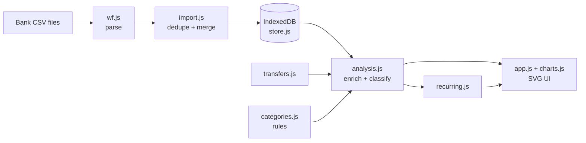

# Architecture

LocalFinance is a static site: HTML, CSS, and ES modules with **no build step, no backend, and no
dependencies**. All logic runs in the browser and all data lives in the browser's IndexedDB.

## Data flow



Nothing is persisted except the raw transactions, accounts, and your rules. Classification
(transfer / investment / income / spending), categories, and recurring payments are **recomputed on
every load** from that raw data. That keeps the stored data small and simple, and it means a
rule or detection improvement applies retroactively to everything you have already imported.

## Modules

| File | Responsibility | Pure (no DOM)? |
|---|---|---|
| `js/csv.js` | RFC 4180 CSV tokenizer (quotes, CRLF, BOM) | yes |
| `js/wf.js` | Wells Fargo layouts to normalized rows (integer cents, ISO dates) | yes |
| `js/import.js` | Merge a file into an account without duplicates | yes |
| `js/transfers.js` | Find card payments, Zelle, and moves between your own accounts | yes |
| `js/categories.js` | Merchant normalization, keyword and user rules | yes |
| `js/analysis.js` | Classify rows; monthly, category, and merchant summaries | yes |
| `js/recurring.js` | Detect subscriptions, bills, income, and recurring investing | yes |
| `js/store.js` | IndexedDB persistence, backup and restore, memory fallback | no (IndexedDB) |
| `js/charts.js` | Hand-written SVG charts | no (returns markup) |
| `js/app.js` | Views, events, dialogs | no |

Everything except `store.js`, `charts.js`, and `app.js` is pure functions over plain objects, which is
why the core logic is covered by fast Node tests with no browser.

## Data model

```
account      { id (slug of its name), name, type: 'checking' | 'credit' }
transaction  { id, accountId, date 'YYYY-MM-DD', description, amount (cents, signed),
               checkNo, status: 'posted' | 'pending', key (dedupe key),
               category (only if set by hand, else null), note }
meta         { key: 'rules', value: [{ match, category, mode? }] }
```

Money is stored as integer cents to avoid floating point errors. Sign convention is the bank's:
negative is money out, positive is money in, for checking and credit cards alike.

## Import and de-duplication

Wells Fargo exports have no transaction id, so posted rows are keyed on
`account | date | amount | description | check # | occurrence`. The occurrence counter lets two truly
identical charges on one day both survive while a re-import of the same file adds nothing.

Pending rows are different: on import, existing pending rows dated on or after the file's earliest date
are removed and re-added from the file. That is how a pending charge becomes a posted one without
showing up twice, even when the bank changes its description when it settles.

## Classification pipeline (`analysis.js: enrich`)

Each transaction becomes exactly one type:

| Type | Meaning | Counted in |
|---|---|---|
| `spending` | money out | spending |
| `refund` | money in on a credit card | reduces spending |
| `income` | money in on a checking account | income |
| `investment` | to or from a brokerage | "Invested" only |
| `transfer` | card payment, Zelle, move between your accounts | nothing |

Precedence, highest first:

1. A category you set by hand. It always wins, so a wrongly detected transfer can be turned back into a
   normal transaction (and the reverse).
2. Detection from `transfers.js` (card payments, Zelle, moves between your accounts). The one exception is a
   brokerage match, which is classified as an investment instead of a plain transfer.
3. Your own rules, then the built-in keyword list, for everything else.


## Not double-counting card payments

Paying your credit card shows up twice: a withdrawal in checking and a positive row on the card.
Counting both would double your spending, so `transfers.js`:

1. Recognizes the checking-side payment by its description.
2. Pairs it with a card row of the same amount within 7 days (nearest date wins).
3. Marks both sides as transfers. Card purchases count when they happen, not when you pay the bill.

If the card file was not imported, the checking-side payment is still excluded. Opposite-sign
transfers between checking accounts are paired the same way, with a 3-day window. Zelle is always a
transfer. A mistyped account type (a card marked as checking) still pairs correctly.

## Recurring detection

Group by normalized merchant, then look for a steady interval (weekly, every 2 weeks, twice a month,
monthly, quarterly, yearly) using the median gap, with tolerances per frequency. Weekly and biweekly
patterns must also have steady amounts, which keeps a weekly grocery trip from looking like a
subscription. Monthly and longer allow variable amounts (a utility bill). At least 3 occurrences are required,
and "active" is judged against the newest transaction date, not today's date, so old exports still behave.

## Categorization

Merchant names are normalized: dates, reference numbers, card digits, and store numbers are stripped
and the first three words kept (for example `PURCHASE AUTHORIZED ON 11/03 NETFLIX.COM 866-579-7172 CA S5833`
becomes `NETFLIX COM CA`). Rules created in the Review screen match the **first two words** of the normalized
merchant as a whole-word prefix, so one choice covers a merchant's variants without capturing
look-alikes. The Review screen groups uncategorized rows the same way, which turns hundreds of
transactions into a short merchant checklist.

## Privacy enforcement

The promise is enforced by the browser, not by trust:

- `index.html` ships a Content Security Policy with `connect-src 'none'` (no network requests), `default-src 'none'`,
  and `script-src`/`style-src` limited to `'self'`.
- There is no inline script or style, and no third-party code of any kind.
- `test/privacy.test.mjs` runs in CI and fails the build if the CSP weakens, any network API or external
  URL appears in the app, or a data-like file (CSV, backup JSON, and so on) is tracked outside `samples/`.
- `.gitignore` blocks data files by default.

## Offline and install

`sw.js` caches the app shell (never user data) with a cache-first strategy limited to same-origin GET
requests. Bump `VERSION` in `sw.js` whenever a cached file changes. The web manifest makes the app
installable to the iOS Home Screen.

## Testing

`npm test` runs Node's built-in test runner over pure logic, using deterministic fake CSVs from
`scripts/make-samples.mjs` plus regression tests for each bug found during manual testing
(unmatched transfers counted as income, blank-number checks, double-escaped memos, and others).

## Tradeoffs and non-goals

- **Restore replaces, not merges.** It is simple and predictable. Merge-by-key restore is on the roadmap.
- **No sync.** Each device keeps its own copy. Sync would need a server or a cloud account, which this project avoids on purpose.
- **Wells Fargo layouts only.** The parser is isolated in `wf.js`, so other banks need only another parser.
- **No AI categorization.** It would send transactions to a server, which breaks the local-only guarantee.
