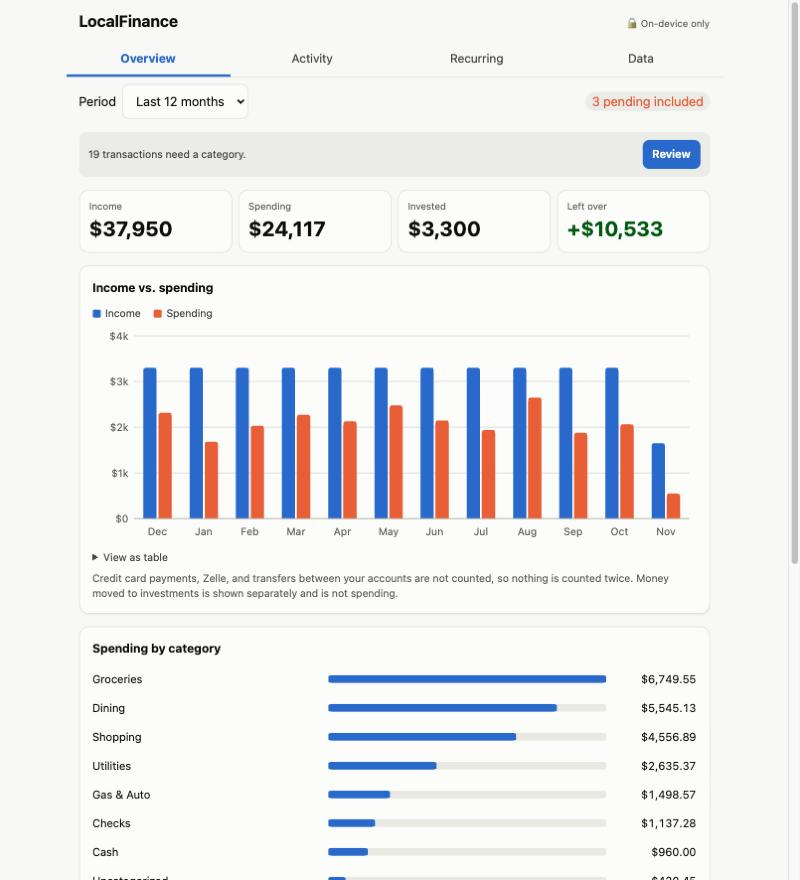
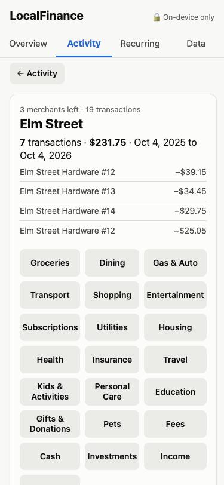
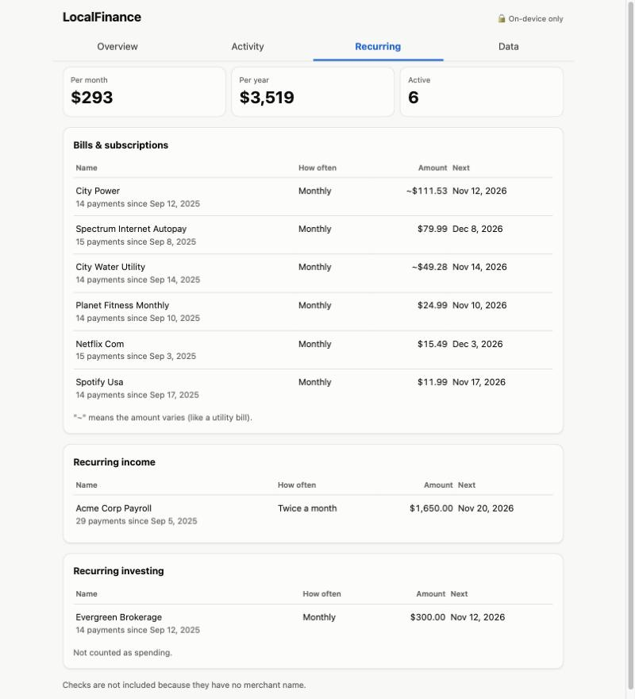

# LocalFinance

**A private, local-first spending analyzer.** Import your bank and credit card CSVs and see where your
money goes: spending by category, recurring bills, checks, investments. Your data never leaves your device.

[](https://github.com/githubacct54385/LocalFinance/actions/workflows/ci.yml)
[](LICENSE)


**[Open the live demo](https://githubacct54385.github.io/LocalFinance/)**. On a phone, use Add to Home Screen to install it.

<p align="center"></p>
<p align="center">
  
  &nbsp;
  
</p>
<p align="center"><sub>Screenshots use the generated fake sample data in <code>samples/</code>.</sub></p>

## Why I built it

Apps like Mint and Rocket Money are useful, but they want your bank login and keep your financial
history on their servers. I wanted the same insight with **no accounts, no cloud, and no trust required**.
So the entire app is static files, the browser itself is told to refuse every network request, and
everything is stored on the device.

## Try it in 30 seconds (no real data needed)

1. Open the [live demo](https://githubacct54385.github.io/LocalFinance/).
2. Download the three fake files from the [`samples/`](samples/) folder.
3. In the app, go to **Data > Choose CSV files** and select all three.
4. Explore Overview, Activity, Recurring, and the Review screen.

The samples are generated, fake data (see [`scripts/make-samples.mjs`](scripts/make-samples.mjs)).

## Features

- **Multiple accounts combined**: any number of checking accounts and credit cards in one view
- **No double-counting**: credit card payments and transfers between your own accounts are detected and
  excluded, so paying your card doesn't count as spending twice
- **Checks** shown as "Check #1234", with an optional payee memo you add on-device
- **Investments** (brokerage transfers) tracked as "Invested", not spending
- **Zelle** treated as a transfer (received or sent by sign), with per-payment override
- **Recurring detection**: subscriptions, utility bills, paychecks, and recurring investing
- **Fast categorizing**: a Review screen walks you through uncategorized transactions one merchant at a time;
  one tap covers every matching transaction and future imports
- **Safe re-imports**: overlapping downloads are de-duplicated, and pending transactions refresh when they post
- **Backup and restore**, to move your data between devices (see below)
- Works on desktop, tablet, and phone; installable as a Home Screen app; light and dark mode

## How privacy is enforced

Privacy here is a property the browser enforces, not a promise.

- The page ships a Content Security Policy with `connect-src 'none'`: the browser refuses any network
  request the app tries to make.
- Zero dependencies, no third-party scripts, fonts, or analytics, and no inline script or style.
- Data lives in the browser's IndexedDB on your device only.
- An automated test suite (run in CI on every push) fails the build if the policy weakens, a network API or
  external URL appears in the app, or a data-like file (CSV, backup JSON) is committed outside `samples/`.

## Under the hood

Plain HTML, CSS, and ES modules with no build step. The core logic is pure functions covered by Node tests.
Money is stored as integer cents. Hand-written SVG charts include a table view.
See **[ARCHITECTURE.md](ARCHITECTURE.md)** for the data flow, the transfer-matching and recurring-detection
algorithms, and the design tradeoffs.

## Move your data between devices

Each device keeps its own copy, but a backup carries everything: accounts, transactions,
your categories, check memos, notes, and rules.

1. On the device with your latest work: **Data > Save backup**.
2. Send the `localfinance-backup-*.json` file to the other device (iCloud Drive or AirDrop).
3. On the other device: **Data > Restore backup**, then choose the file.

Notes:
- Restore **replaces** everything on the device you restore into. It does not merge, so move data
  one direction at a time (desktop to phone, or phone to desktop).
- On iPhone, Safari and the Home Screen app store data separately. Restore into the one you use.
- If Save backup does nothing in the Home Screen app, open the site in Safari and save from there.
- A backup contains your transactions. Delete it when you are done; never commit it
  (`.gitignore` blocks `*backup*.json`).

## Run locally

```bash
python3 scripts/dev-server.py 8080   # then open http://localhost:8080 (serves with caching off)
npm test                             # unit tests and privacy guards (Node 22+, no install needed)
node scripts/make-samples.mjs        # regenerate the fake sample CSVs
```

## Deploy

Push to GitHub, then Settings > Pages > Deploy from branch `main`, folder `/ (root)`. All paths are
relative, so it works at `https://<user>.github.io/<repo>/`. After changing any cached file, bump `VERSION`
in `sw.js` so installed copies update.

## Limitations and roadmap

- Supports Wells Fargo CSV layouts today. Other banks need a parser in `js/wf.js`'s style.
- Restore replaces rather than merges. A merge-by-key restore would make two-way use safer.
- No sync between devices, by design: it would need a server or cloud account.
- Ideas: optional passcode lock with on-device encryption, split transactions, budgets and goals.

## License

[MIT](LICENSE)
